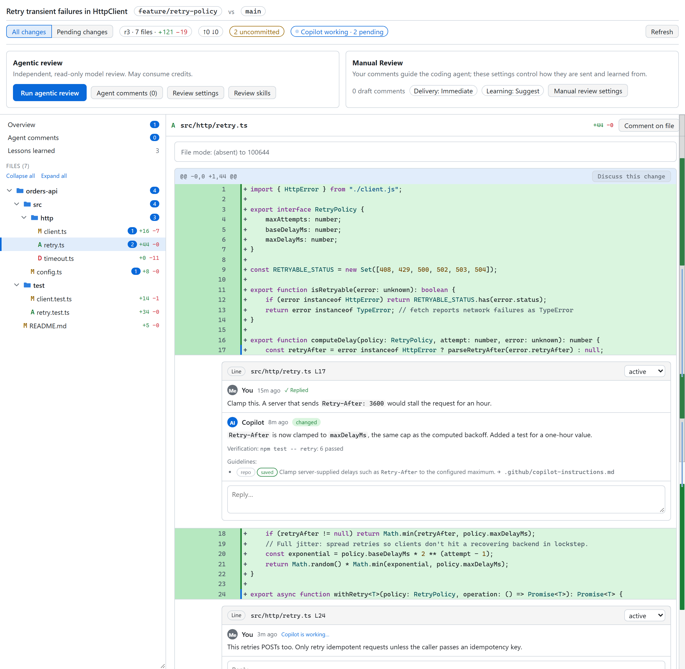
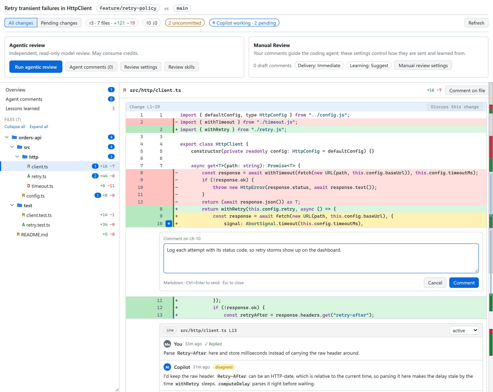
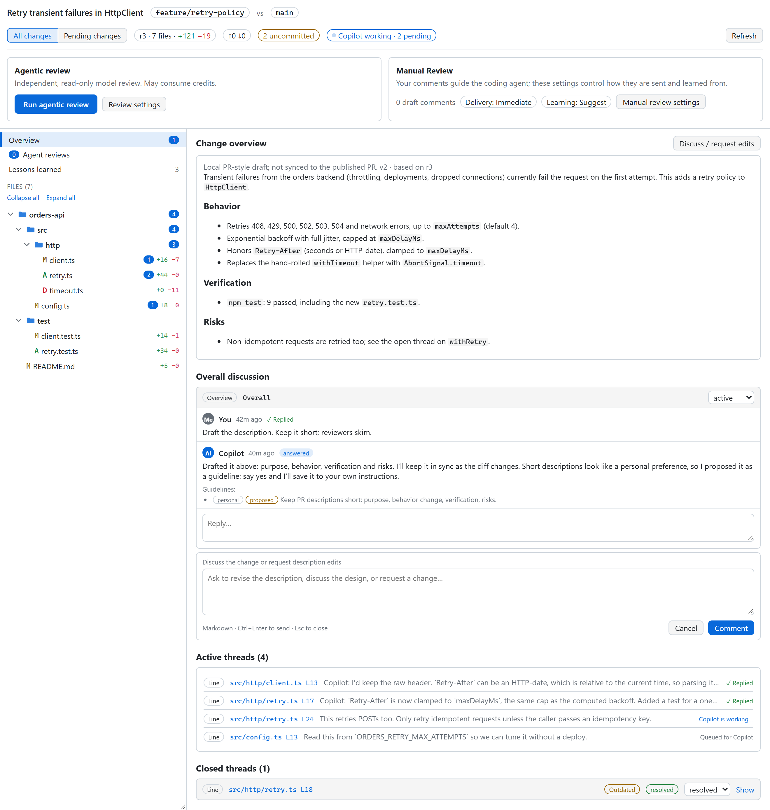
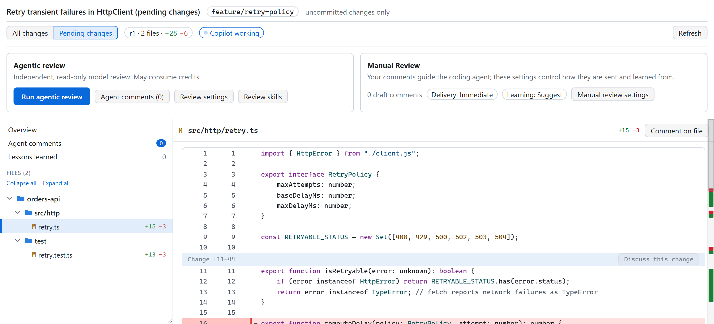
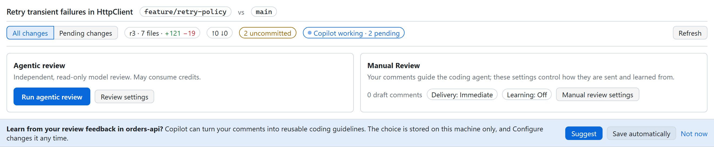
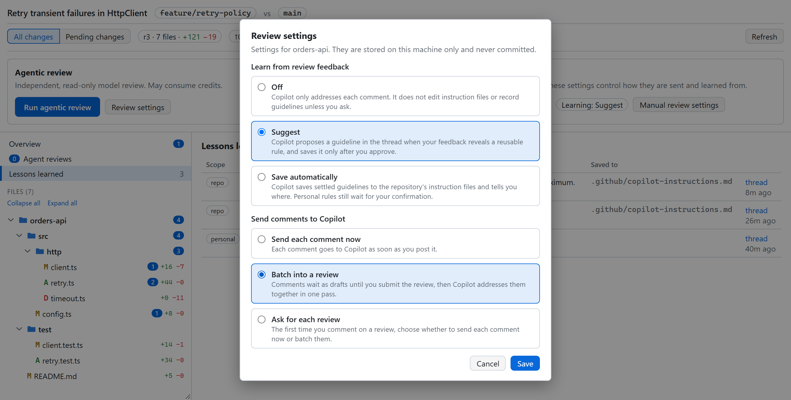
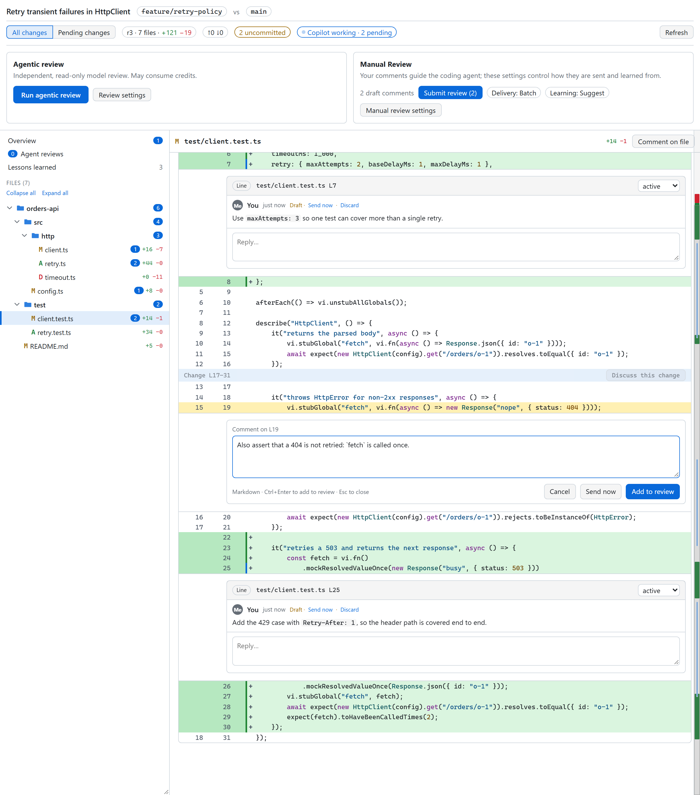
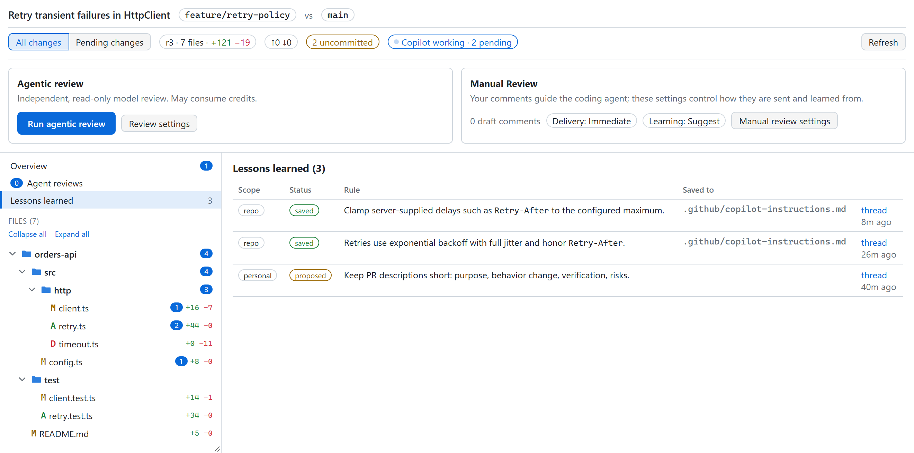

# Self-Review

A human-led diff and review canvas for the GitHub Copilot app. Inspect local changes in a rich diff view, then steer your agent with inline feedback to fine-tune the implementation.

```bash
copilot plugin marketplace add SergeyTeplyakov/Self-Review
copilot plugin install self-review-canvas@self-review-canvas
```

In the Copilot app, [install Self-Review](https://github.com/copilot/app/launch?open=ghapp%3A%2F%2Fplugins%2Finstall%3Fsource%3Dself-review-canvas%2540self-review-canvas%26marketplace%3DSergeyTeplyakov%252FSelf-Review). It asks you to confirm adding the `SergeyTeplyakov/Self-Review` marketplace and installing `self-review-canvas@self-review-canvas`, then opens the install form pre-filled. Click Install to finish.

Or do it by hand: **Customize → + Add → Marketplace** with `SergeyTeplyakov/Self-Review`, then **+ Add → Plugin** with `self-review-canvas@self-review-canvas`.

Start a new session in a repository with some changes and try a read-only review:

```text
Open my changes against origin/main in the self-review canvas. Don't change anything until I comment.
```

You get a PR-style review of your local changes. Select a line, write a comment, click **Comment**, and the agent picks it up in the same conversation, fixes it or answers, and replies in the thread. Prefer to read everything first? Switch the repository to batch delivery and submit all your comments at once, like a PR review.

To review only what you haven't committed yet, ask for your pending changes instead, or switch between **All changes** and **Pending changes** in the top bar at any time.

## Why

Agents write code faster than you can read it. Reviewing in chat is awkward: you paste file names and line numbers, describe which `if` you mean, and lose track of what was already addressed. PR tools have the right shape for this, but they only kick in after you push, and their comments go to people, not to the agent that wrote the code.

Self-Review brings a rich diff view and the PR review loop to your working tree. Read whole files with changes inline, use syntax highlighting to follow the code, and review Markdown without losing its source markers. Compare a whole branch or focus on pending edits. You read the changes and decide what matters.

Use it while the implementation is taking shape, not just for a final check. Select a line or block and ask your agent to use an existing helper, preserve a behavior, simplify an approach, or adjust the design. Each comment carries the exact file, side, line range, and surrounding hunk. The agent makes the edits or answers, replies in the thread, and the diff refreshes so you can keep steering. Send feedback immediately or collect it into a batch. Nothing is pushed, published, or committed unless you ask for it.

Optionally, the agent also learns from your comments. Choose per repository whether it stays off, proposes guidelines for you to approve, or saves them to your repository instructions on its own, so you don't have to make the same comment twice.

## What it looks like

Threads sit next to the code they're about. The agent replies with what it changed, how it verified it, and, when learning is on, the guideline it proposed or saved. The top bar shows when the agent is still working.

<picture>
  <source media="(prefers-color-scheme: dark)" srcset="docs/images/conversation-dark.png">
  
</picture>

Select lines on either side of the diff to start a thread.

<picture>
  <source media="(prefers-color-scheme: dark)" srcset="docs/images/comment-dark.png">
  
</picture>

The overview has the PR-style description the agent drafted, the overall discussion, every thread with its delivery state, and the revision history.

<picture>
  <source media="(prefers-color-scheme: dark)" srcset="docs/images/overview-dark.png">
  
</picture>

Review the whole branch against its base, or switch to **Pending changes** to look only at what you haven't committed. Each scope is its own review with its own threads.

<picture>
  <source media="(prefers-color-scheme: dark)" srcset="docs/images/pending-dark.png">
  
</picture>

Learning from your feedback is optional and set per repository. The first review in a repository asks once.

<picture>
  <source media="(prefers-color-scheme: dark)" srcset="docs/images/banner-dark.png">
  
</picture>

**Configure** in the top bar changes the choice any time, along with how your comments reach the agent: send each one as you post it, batch them into a review, or ask for each review. Both settings are stored on your machine and never committed.

<picture>
  <source media="(prefers-color-scheme: dark)" srcset="docs/images/configure-dark.png">
  
</picture>

In batch mode, **Add to review** keeps a comment as a draft the agent can't see yet. Work your way through the diff, send or discard any single draft, then click **Submit review** to hand them all over in one message. The agent works through them in one pass and replies in each thread.

<picture>
  <source media="(prefers-color-scheme: dark)" srcset="docs/images/batch-dark.png">
  
</picture>

Guidelines learned from your comments are collected in one place, with their status (proposed, saved, or declined) and where each one went.

<picture>
  <source media="(prefers-color-scheme: dark)" srcset="docs/images/lessons-dark.png">
  
</picture>

## How it works

- **Scope.** **All changes**, the default, compares your working tree, including staged, unstaged, and untracked files, against the merge base with a base ref (`origin/HEAD`, `main`, or `master` by default), so it covers a whole branch or PR. **Pending changes** compares the working tree with `HEAD`, so it covers only what you haven't committed and needs no comparison base. When switching to All changes, a base is inferred or must be supplied explicitly. Each scope keeps its own threads, and you switch between them in the top bar. Narrow either one to paths or exclude files when you open it.
- **Comments.** Start a thread on the overview, a file, a change, or a line range on either side of the diff. Selecting a file shows the whole file with changes inline; selecting a folder shows only the diffs under it.
- **Highlighting.** Code is syntax highlighted locally. Markdown stays as source, with every marker such as `**`, `#`, and `[text](url)` left in place, but headings, emphasis, inline code, links, lists, quotes, tables, and fenced code blocks are styled so prose changes are easy to read.
- **Diff details.** Final-newline notes identify the affected side, file modes are shown explicitly, and file-to-symlink replacements keep both sides together. Untracked files are fingerprinted from their bytes, including binary and oversized files that cannot be displayed.
- **Delivery.** Set per repository. **Immediate**, the default, starts a turn in the conversation that owns the canvas as soon as you post a comment. **Batch** keeps comments as drafts until you click **Submit review**, which sends every draft in one message; any draft can also be sent on its own or discarded, and the agent never sees a draft until it is sent. **Ask** lets you choose immediate or batch the first time you comment on each review. The state of each comment is visible on the thread: draft, saving, queued, processing, replied, no reply (the agent finished without answering), or failed, with a resend for the last two. A comment is never shown as delivered just because you clicked a button.
- **Replies.** The agent answers in the thread with an outcome (answered, changed, blocked, disagreed, or needs input), how it verified the change, and any guideline it proposed or saved.
- **Learning.** Off until you choose, per repository. **Off** only addresses each comment. **Suggest** proposes a guideline in the thread and saves it only after you approve. **Save automatically** writes settled guidelines to the repository's instruction files and tells you where; personal rules still wait for your confirmation. The first review in a repository asks once, and **Configure** changes it later. The **Lessons learned** list shows each guideline as proposed, saved, or declined.
- **Refresh.** When the agent goes idle, the canvas captures a new revision. Threads follow their code when lines shift. If the commented code is gone, the thread keeps the original snippet and is marked outdated, not resolved.
- **Statuses.** Threads are active, resolved, won't fix, or closed. You decide when something is resolved, or tell the agent to resolve threads it has addressed.
- **Review controls.** Change title, branch/base, scope, revision, Git state, and Copilot status appear first. When GitHub CLI finds one open pull request for the reviewed branch, the header links to its reported URL; no link appears without a unique matching PR. Below them, separate **Agentic review** and **Manual Review** panels distinguish independent model review from your comments and repository feedback settings. The agentic panel shows its finding count and **Review settings**; the manual panel shows draft count, delivery and learning modes, and **Manual review settings**.
- **Agentic review.** Enter one to four reviewers: exact model IDs available to your session, or `copilot-fusion`. Without saved defaults or a previous run, the dialog suggests `gpt-6-astra`, `gpt-6.1-sol`, and `copilot-fusion`; edit them freely, and nothing runs until you click **Run review**. Choose review, simplification, or both. Optionally add a goal, acceptance criteria, spec reference, or review guidance. The owning conversation launches independent read-only reviewers using those models; this consumes credits and requires model-selectable subagent support. Models are never silently substituted: unavailable models and failed reviews are shown explicitly. Each reviewer can report up to 20 findings labelled with its model, category, severity, and assessment. **Approve** sends a confirmed, actionable finding to the coding agent for implementation; **Discuss** opens its reply box without requesting a fix. Manual review remains available throughout.
- **Agent review defaults.** **Review settings** lets you save models, focus, and guidance for your user across repositories. **Save defaults** saves without starting a review. Enable **Run with saved defaults without asking again** for one-click review of the current scope and revision; opening a canvas never starts work. The separate settings button always lets you change the choices or turn confirmation back on. Saved guidance applies to every repository, so keep repository-specific acceptance criteria in a one-off run. Defaults live under `agentReview` in `~/.copilot/extension-data/self-review/settings.json`, outside the checkout. The `get_agent_review_settings` and `set_agent_review_settings` canvas actions also support explicit preconfiguration; `run_agent_review` with `useDefaults: true` reuses it without another model-selection question. Host permission prompts and approval before fixes still apply.
- **Agent comments.** The toolbar and sidebar show the number of agent findings, separately from manual comments and replies. Click **Agent comments** to read them together, with active/closed and older-revision counts. Counts cover all runs in the selected All/Pending scope, not other scopes or repositories; each run also shows its own count. Zero comments is not a successful-review claim: run errors, pending reviewers, and coverage limits remain visible.
- **Review revisions.** Agent reviews use a pinned diff in the current All/Pending scope, including the review's path filters. Their input excludes held manual drafts. Results and coverage/verification summaries are saved per model; no findings reported is distinct from a failed, missing, or unverified result. A changed diff disables approval of older suggestions; rerun the review or discuss the change explicitly. **Close review** stops accepting results, but does not stop agents already running. No agent review runs automatically.
- **Local storage.** The canvas is served from `127.0.0.1` with a per-panel token. Reviews and your learning and delivery settings are stored in `~/.copilot/extension-data/self-review`, never in the repository. Sending comments or running agent reviews shares the relevant context with your Copilot session and selected models; the canvas does not publish comments to GitHub.

Symlinks are shown as their link-target text, not the contents of the target. Full-file selections are checked against the saved revision before creating an anchor or delivering code context; refresh and check the selection again if the file has changed.

Concurrent sessions coordinate storage updates with exclusive lock files. A lock timeout reports the exact path rather than risking lost updates. If a crashed provider leaves a lock behind, stop all self-review providers before removing that specific lock file under `~/.copilot/extension-data/self-review/locks`.

## Review guidance and optional skills

Copilot Fusion runs through the `copilot-fusion` reviewer. It is not a subagent model ID: the owning conversation starts one coordinated child chat session with the Auto model and the host's Copilot Fusion tier (for example High), gives it the pinned diff and the same read-only rules, and validates its findings like any other reviewer's. Child messages are provisional until the child finishes; the coordinator then reconciles its replies before saving one immutable result. Its result can arrive after the conversation's turn ends, and the canvas shows it as awaiting the child session until then. If the host cannot create the child session, or Auto or a Fusion tier is unavailable, the run reports a failure for `copilot-fusion`; it never substitutes a model or changes your conversation's model to emulate Fusion.

Reviewers read repository standards and relevant tests, check the stated intent rather than inventing requirements, and focus on evidence rather than stylistic quotas. The owning conversation validates their candidate findings against the pinned change and its baseline, including relevant callers, guards, and tests, before posting the results. It does this without launching an extra validator model. Missing context or a spec that could not be read is a reported limitation, not a pass.

Each finding records source/requirement evidence, a baseline comparison, and validation reasoning or limits. Assessments are **Confirmed**, **Pre-existing**, **Rejected**, or **Unverified**. Only confirmed findings with evidence and an actionable severity can be approved; informational **FYI** findings and the other assessments remain available for discussion. Older suggestions without this evidence also require discussion or a fresh review. Agreement between models is not proof, and a review with no findings is valid.

These assessments are supplied by the coordinating agent. The canvas checks the report's structure, locations, and revision, but does not independently prove a claim or attest that a model ran tests. The per-model **Coverage and verification** summary distinguishes inspected code, checks actually performed, and missing evidence. Review itself does not mutate files or run builds; verification requiring execution needs separate authorization. After approval, the coding agent rechecks the finding before making changes.

Simplification is scoped to the reviewed material and must preserve behavior: outputs, errors, side effects, ordering, and prose meaning. Reviewers first establish why the existing code or content exists, then propose a concrete improvement in comprehension, not merely fewer lines. Generic cleanup advice does not override repository conventions or justify unrelated refactoring.

**You can use Addy Osmani's skills with this canvas.** If installed in your Copilot environment, request [`code-review-and-quality`](https://github.com/addyosmani/agent-skills/tree/main/skills/code-review-and-quality) and/or [`code-simplification`](https://github.com/addyosmani/agent-skills/tree/main/skills/code-simplification) in the review guidance field or conversation. For example:

```text
Use Addy Osmani's code-review-and-quality and code-simplification skills if available.
Validate candidate findings against the code and baseline. Keep the review read-only.
If the skills are unavailable, say so and use the canvas's built-in review guidance.
```

They are optional, not bundled dependencies, and nothing is downloaded or installed automatically. Follow the installation instructions in [Addy's agent-skills repository](https://github.com/addyosmani/agent-skills) for your client, then start a session that can discover them. A report should name only skills that were actually loaded. Using another skill does not authorize mutation tests in your checkout, automatic fixes, extra model calls, commits, or publication.

The built-in review approach draws on [Addy's evidence-based review and simplification workflows](https://github.com/addyosmani/agent-skills), [Matt Pocock's standards/spec separation](https://github.com/mattpocock/skills/tree/main/skills/engineering/code-review), and [poteto's adversarial review perspectives](https://github.com/poteto/noodle/tree/main/.agents/skills/adversarial-review). It works without installing those skills.

## What's inside

| Path | What it is |
|------|------------|
| [`extensions/self-review/`](extensions/self-review/) | The canvas: diff view, threads, comment delivery, and the actions the agent uses to reply. |
| [`skills/self-review/`](skills/self-review/) | The skill that tells the agent how to run the review loop: open the right comparison, process comments, reply, and, when you turn learning on, capture guidelines. |

Canvases are a GitHub Copilot app feature. The skill loads in Copilot CLI too, but without the canvas there is nothing to comment on.

## Updating

```bash
copilot plugin update self-review-canvas@self-review-canvas
```

Then start a new session.

### Upgrading from Manual Review Canvas

This project was renamed from Manual Review Canvas, and its plugin, marketplace, canvas, and skill IDs changed. Replace the old install:

```bash
copilot plugin uninstall manual-review-canvas@manual-review-canvas
copilot plugin marketplace remove manual-review-canvas
copilot plugin marketplace add SergeyTeplyakov/Self-Review
copilot plugin install self-review-canvas@self-review-canvas
```

Then start a new session. On first start, existing reviews and settings are copied from `~/.copilot/extension-data/manual-review` to `~/.copilot/extension-data/self-review`. The old directory is left in place; delete it yourself once you no longer run the old version.

## Hacking on it

Clone the repo, then run `copilot plugin marketplace add <path-to-clone>` and `copilot plugin install self-review-canvas@self-review-canvas`. It loads straight from your checkout, so edits show up in your next session.

Run the tests from `extensions/self-review`:

```bash
node --test test
```

The screenshots in this README come from a script that builds a demo repository, seeds a review, and captures the canvas in light and dark themes with Playwright, using your installed Edge or Chrome:

```bash
cd docs/screenshots
npm install
node render.mjs
```

Pass `--keep` to leave the demo review running and print its URL.

## Status

Early. Issues and PRs welcome.

## License

MIT. See [LICENSE](LICENSE).
