# Self-Review

A human-led diff and review canvas for the GitHub Copilot app. Inspect local changes in a rich diff view, then steer your agent with inline feedback to fine-tune the implementation.

```bash
copilot plugin marketplace add SergeyTeplyakov/Self-Review
copilot plugin install self-review-canvas@self-review-canvas
```

In the Copilot app, [install Self-Review](https://github.com/copilot/app/launch?open=ghapp%3A%2F%2Fplugins%2Finstall%3Fsource%3Dself-review-canvas%2540self-review-canvas%26marketplace%3DSergeyTeplyakov%252FSelf-Review). It asks you to confirm adding the `SergeyTeplyakov/Self-Review` marketplace and installing `self-review-canvas@self-review-canvas`, then opens the install form pre-filled. Click Install to finish.

Or do it by hand: **Customize → + Add → Marketplace** with `SergeyTeplyakov/Self-Review`, then **+ Add → Plugin** with `self-review-canvas@self-review-canvas`.

Start a new session in a repository with some changes and try a read-only review:

```text
Open my changes against origin/main in the self-review canvas. Don't change anything until I comment.
```

You get a PR-style review of your local changes. Select a line, write a comment, click **Comment**, and the agent picks it up in the same conversation, fixes it or answers, and replies in the thread. Prefer to read everything first? Switch the repository to batch delivery and submit all your comments at once, like a PR review.

To review only what you haven't committed yet, ask for your pending changes instead, or switch between **All changes** and **Pending changes** in the top bar at any time.

The file tree root uses the repository name from `origin`, not a generated worktree-folder name. For local-only repositories, each checkout uses its own folder name unless a common `core.worktree` identifies the main checkout; bare repositories use the bare repository folder name. Hover over the root to see the full checkout path and review scope; the root folder view uses the same repository label.

## Why

Agents write code faster than you can read it. Reviewing in chat is awkward: you paste file names and line numbers, describe which `if` you mean, and lose track of what was already addressed. PR tools have the right shape for this, but they only kick in after you push, and their comments go to people, not to the agent that wrote the code.

Self-Review brings a rich diff view and the PR review loop to your working tree. Read whole files with changes inline, use syntax highlighting to follow the code, and review Markdown without losing its source markers. Compare a whole branch or focus on pending edits. You read the changes and decide what matters.

Use it while the implementation is taking shape, not just for a final check. Select a line or block and ask your agent to use an existing helper, preserve a behavior, simplify an approach, or adjust the design. Each comment carries the exact file, side, line range, and surrounding hunk. The agent makes the edits or answers, replies in the thread, and the diff refreshes so you can keep steering. Send feedback immediately or collect it into a batch. Nothing is pushed, published, or committed unless you ask for it.

The agent can turn settled feedback into reusable guidelines so you don't have to make the same comment twice. Review and save the proposals yourself, or enable automatic saving for the repository.

## What it looks like

Threads sit next to the code they're about. The agent replies with what it changed, how it verified it, and any reusable guideline it learned from your feedback. The top bar shows when the agent is still working.

<picture>
  <source media="(prefers-color-scheme: dark)" srcset="docs/images/conversation-dark.png">
  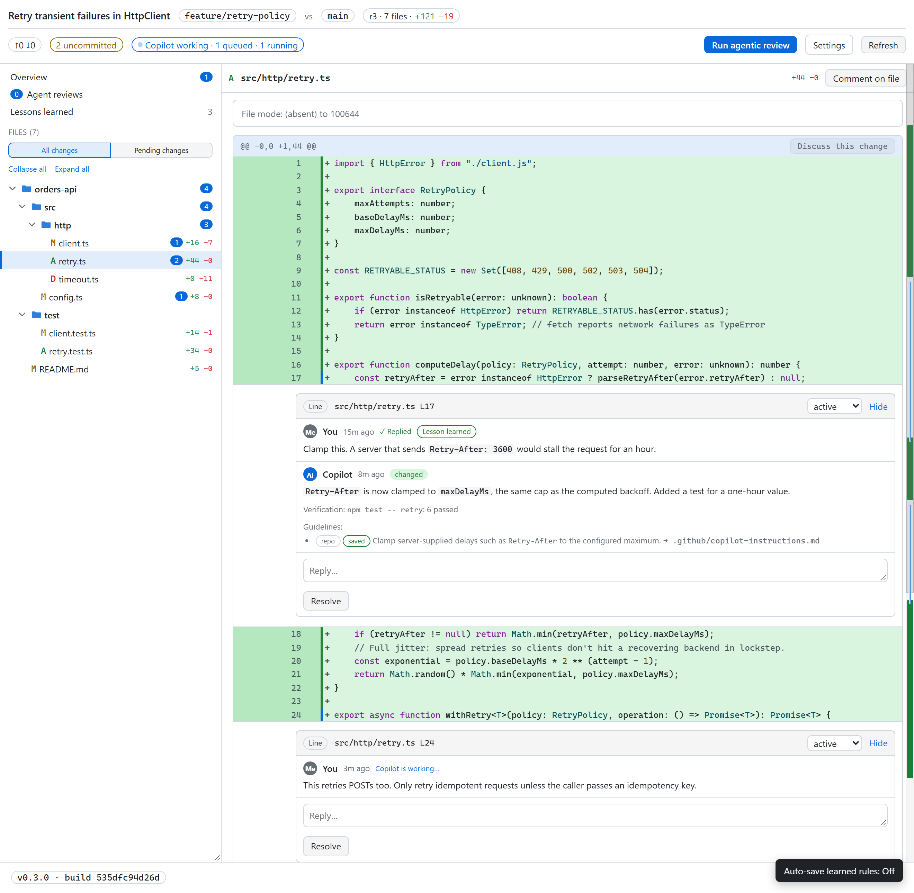
</picture>

Select lines on either side of the diff to start a thread.

<picture>
  <source media="(prefers-color-scheme: dark)" srcset="docs/images/comment-dark.png">
  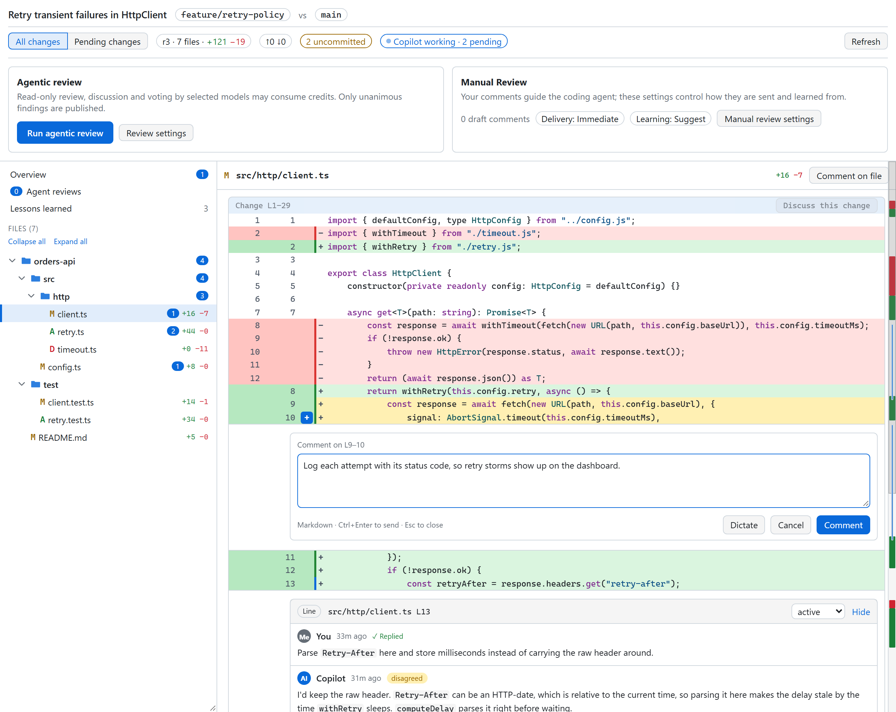
</picture>

The overview has the PR-style description the agent drafted, the overall discussion, and every thread with its delivery state. Revision snapshots still anchor threads and agent reviews but are not listed on the overview.

A fixed-height footer shows when the review and Overview are loading or refreshing without moving the file tree, Overview, or controls. The last loaded review stays visible while updates arrive. Errors remain in the footer with **Retry**, without discarding your navigation or comment drafts. A missing description means no draft has been saved, not that generation is underway: ask Copilot in the Overview discussion to write one. Descriptions based on an earlier diff are explicitly labeled until the agent updates them.

<picture>
  <source media="(prefers-color-scheme: dark)" srcset="docs/images/overview-dark.png">
  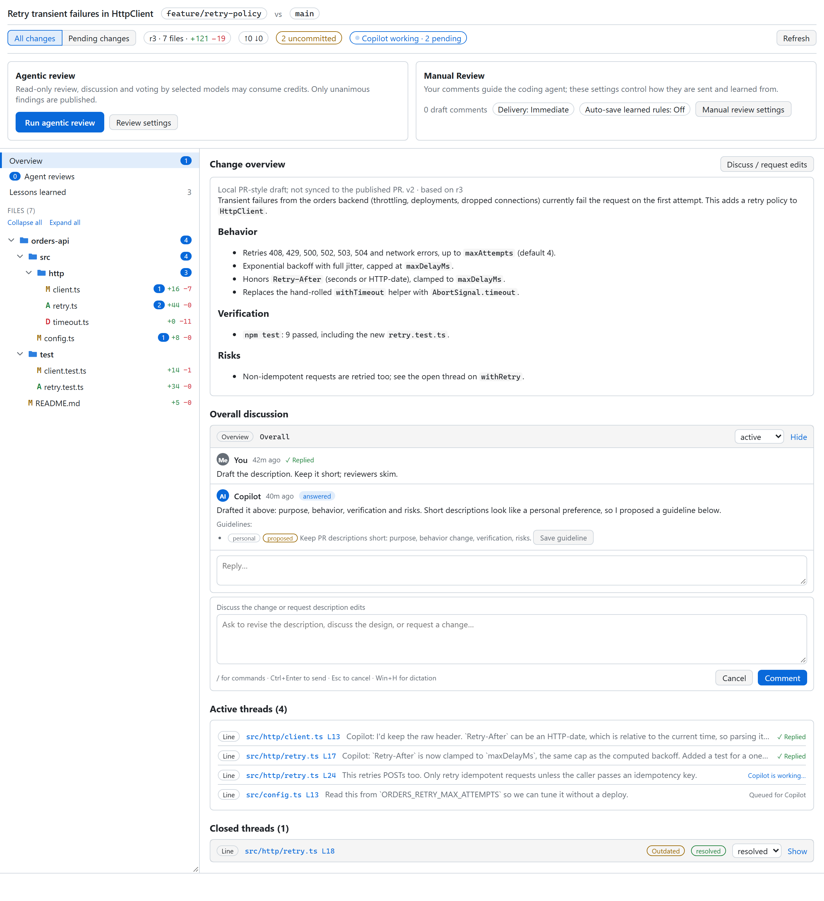
</picture>

Review the whole branch against its base, or switch to **Pending changes** to look only at what you haven't committed. Each scope is its own review with its own threads.

<picture>
  <source media="(prefers-color-scheme: dark)" srcset="docs/images/pending-dark.png">
  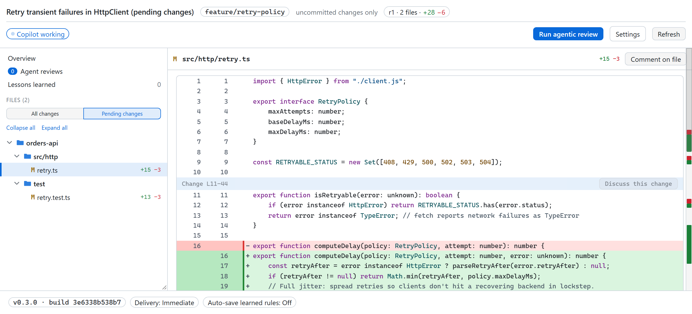
</picture>

Proposals are available whether or not automatic saving is enabled. The first review in a repository offers a choice between saving them yourself and enabling **Auto-save learned rules**.

<picture>
  <source media="(prefers-color-scheme: dark)" srcset="docs/images/banner-dark.png">
  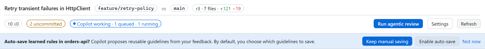
</picture>

**Configure** in the top bar changes the choice any time, along with how your comments reach the agent: send each one as you post it, batch them into a review, or ask for each review. Both settings are stored on your machine and never committed.

<picture>
  <source media="(prefers-color-scheme: dark)" srcset="docs/images/configure-dark.png">
  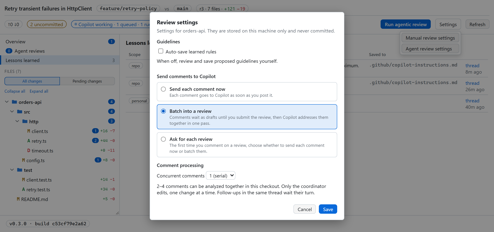
</picture>

In batch mode, **Add to review** keeps a comment as a draft the agent can't see yet. Work your way through the diff, send or discard any single draft, then click **Submit review** to hand them all over in one message. The agent works through them in one pass and replies in each thread.

<picture>
  <source media="(prefers-color-scheme: dark)" srcset="docs/images/batch-dark.png">
  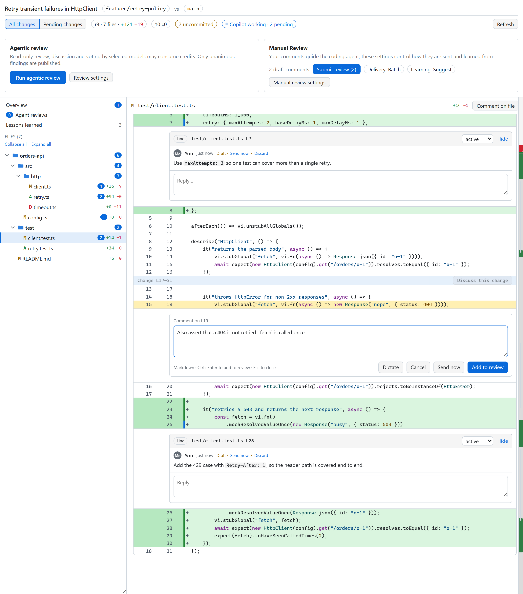
</picture>

Guidelines learned from your comments are collected in one place, with their status (proposed, saved, or declined) and where each one went.

<picture>
  <source media="(prefers-color-scheme: dark)" srcset="docs/images/lessons-dark.png">
  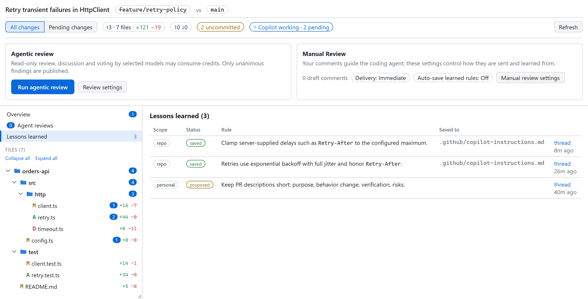
</picture>

Changed images get a visual diff. Compare **Before** and **After** side by side, swipe a divider across them, or fade one over the other; each side lists its dimensions and size.

<picture>
  <source media="(prefers-color-scheme: dark)" srcset="docs/images/image-diff-dark.png">
  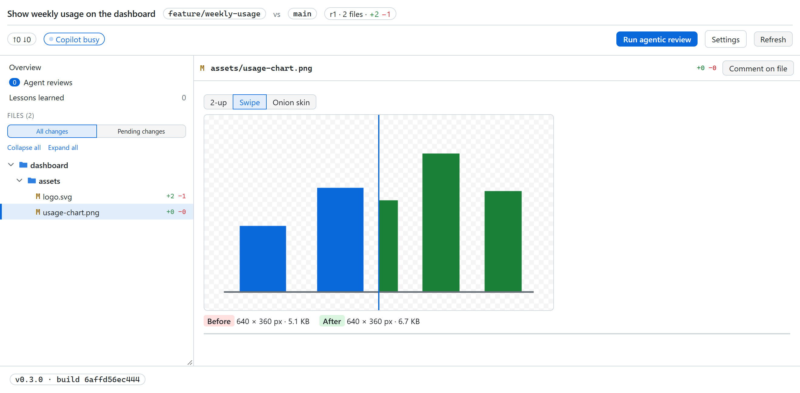
</picture>

## How it works

- **Scope.** **All changes**, the default, compares your working tree, including staged, unstaged, and untracked files, against the merge base with a base ref (`origin/HEAD`, `main`, or `master` by default), so it covers a whole branch or PR. **Pending changes** compares the working tree with `HEAD`, so it covers only what you haven't committed and needs no comparison base. When switching to All changes, a base is inferred or must be supplied explicitly. Each scope keeps its own threads, and you switch between them with the controls above **Files** in the sidebar. Narrow either one to paths or exclude files when you open it. Historical single-commit reviews are no longer supported: reviews saved by earlier versions stay on disk with their notes untouched, but cannot be opened, refreshed, or commented on; a canvas that last showed one reopens on the review it was opened from, or on the repository's All changes review, and logs a warning.
- **Review controls.** **Settings** and **Run agentic review** are in the header; the revision summary sits beside the branch and base. The bottom status bar shows the running extension version and build date on the left; hover over or focus it to see the build ID. Refresh progress or errors appear on the right. The version comes from the serving extension's own distribution, not the repository being reviewed, and the date is when that distribution's build ID last changed. Delivery and auto-save preferences are in **Settings**; an **Ask**-mode review that has chosen its delivery also shows **Change delivery** in the status bar. Draft counts and **Submit review** appear in the header only while comments are waiting to be sent.
- **Comments.** Start a thread on the overview, a file, a change, or a line range on either side of the diff. Selecting a file shows the whole file with changes inline; selecting a folder shows only the diffs under it. An empty reply box stays one line high until you click it, then expands; drag its corner to resize it vertically before or after clicking.
- **File locations.** Hover over a file in the tree, or use the folder button in its file header, to show the local file in your file manager: **Reveal in File Explorer** on Windows selects it in Explorer, **Reveal in Finder** on macOS, and **Open containing folder** on Linux opens its folder. A deleted file opens its nearest folder that still exists instead. Only paths inside the reviewed checkout are opened, and the file itself is never launched.
- **Highlighting.** Code is syntax highlighted locally. Markdown stays as source, with every marker such as `**`, `#`, and `[text](url)` left in place, but headings, emphasis, inline code, links, lists, quotes, tables, and fenced code blocks are styled so prose changes are easy to read.
- **Diff details.** Final-newline notes identify the affected side, file modes are shown explicitly, and file-to-symlink replacements keep both sides together. Untracked files are fingerprinted from their bytes, including binary and oversized files that cannot be displayed.
- **Image diffs.** Select a changed PNG, JPEG, GIF, WebP, or SVG in the tree, or expand its folder, to see **Before** and **After** side by side (**2-up**), each labeled with its pixel dimensions and file size. When both sides load and differ, two more modes appear: **Swipe** lays After over Before and reveals Before left of a divider you drag (or move with the arrow keys), and **Onion skin** fades After over Before with a slider. Both layers start at the top-left corner of a stage sized to the larger image, so pixels at the same position line up. The canvas keeps each file's mode until you switch reviews. Additions (including untracked files) and deletions show only the side that exists. A pure rename or mode-only change shows the unchanged image on both sides. An SVG is shown as an image from a `data:` URL, never as live markup, so its scripts and external references don't run; its text diff stays below the preview. Previews follow the file's bytes, not how Git diffs it: an image Git treats as text, such as a JPEG with a long leading comment, still previews, while text with an image name, such as a Git LFS pointer, keeps its text diff. Each preview is local, limited to 2 MB, loaded as it scrolls near view, and tied to the selected revision: **Before** is from HEAD in Pending changes or from the comparison base in All changes. A side that is unsupported, unreadable, too large, or changed since the revision says so; a binary file whose previews all fail falls back to "Binary file not shown." If an unstaged image has changed again, refresh rather than comparing against the wrong bytes. A review created by an earlier version gains previews at its next refresh, which records a new revision. Use **Comment on file** to discuss an image.
- **Delivery.** Set per repository in **Settings**. **Immediate**, the default, starts a turn in the conversation that owns the canvas as soon as you post a comment. **Batch** keeps comments as drafts until you click **Submit review**, which sends every draft in one message; any draft can also be sent on its own or discarded, and the agent never sees a draft until it is sent. **Ask** lets you choose immediate or batch the first time you comment on each review. The state of each comment is visible on the thread: draft, saving, queued, processing, replied, no reply (the agent finished without answering), or failed, with a resend for the last two. A comment is never shown as delivered just because you clicked a button.
- **Comment processing.** Under **Settings → Manual review settings**, leave **Concurrent comments** at **1 (serial)** or choose **2–4** for this repository. Parallel dispatch and wake-ups are sent immediately; the owning conversation is instructed to start eligible read-only analyses up to the configured limit, including while earlier analyses are still running. A comment may still wait when all slots are occupied or its thread is busy. Workers are instructed to answer questions or propose edits without writing. The owning conversation applies explicitly requested edits one at a time after current analyses report, rechecks dependencies and verifies the result. If the reviewed diff changed, a proposal gets fresh analysis before application; an outdated anchor or changed branch or HEAD instead requires a recheck and resend. There are no checkout copies to merge. The header shows the configured limit and separate queued and running comment counts; each thread shows whether it is analyzing, waiting to apply, or applying. These are comment assignments, not a list of desktop sessions. Delivery mode still decides when comments enter the queue; parallel analysis uses the host's background tasks and normal Copilot permissions and usage. See [Comment lifetime](docs/comment-processing.md#comment-lifetime) for the state diagram and scheduling rules.
  When parallel processing is active, click the **Parallelism: N** badge in the header to open Settings with **Concurrent comments** focused.
- **Replies.** The agent answers in the thread with an outcome (answered, changed, blocked, disagreed, or needs input), how it verified the change, and any guideline it proposed or saved. Clicking an HTTP(S) Markdown link opens it in your system's default browser, not in the canvas. Raw HTML is displayed as text.
- **Learning.** Self-Review routes repository guidelines through per-user path-prefix mappings, so rules can live with the area and language they cover. Unmapped rules stay proposals until you confirm a destination; personal rules keep going to `~/.copilot/copilot-instructions.md`. See [Learned rule destinations](docs/learned-rule-destinations.md) for setup, routing, and the ErrorProne.NET example.
- **Review commands.** Type `/` at the start of a comment or reply to see only the built-in Self-Review commands. Use the arrow keys to highlight one and press **Tab** or **Enter** to insert it; Shift+Tab still moves focus. Choose **`/explain`** to ask about the selected lines, file, or overall review without making edits, or **`/learn`** to get a reusable rule and its scope in-thread in either auto-save setting. Copilot asks for clarification if there isn't enough context to infer a rule. Add a question or feedback after the command, or use the thread's context. Commands can be sent now or held for batch submission like any comment. The original comment shows **Lesson learned** only after a verified save.
- **Images in comments.** Paste an image from the clipboard into a comment or reply and use its thumbnail’s remove button to take it out before posting. Comments can contain only images, or mix them with text. Each comment can contain up to four PNG, JPEG, GIF, or WebP images, up to 2 MB each. A batch can include up to 16 MB of images in total. If it exceeds that limit, your drafts stay intact; send some comments individually before submitting the rest. Images are stored locally with the review and attached to the Copilot message.
- **Windows voice typing.** On Windows, focus the comment or reply and press **Win+H** to open the operating system’s voice typing. Self-Review displays the shortcut but does not record audio itself.

The command prompts live in [`/explain`](extensions/self-review/review-commands/explain/SKILL.md) and [`/learn`](extensions/self-review/review-commands/learn/SKILL.md). The build bundles these Markdown files, and Self-Review loads the applicable sections when delivering a command.
- **Refresh.** Open panels wait for a quiet interval after relevant checkout events before automatically capturing a new revision, whether the changes come from an agent, an editor, or Git. Git-ignored output does not restart this interval. If relevant checkout activity is detected before the new revision is published, the last good revision stays visible and the capture is retried once activity settles. Refresh progress and errors appear in the fixed bottom status bar; long errors remain contained there with **Retry** available. The provider watches the working tree and relevant Git metadata (including linked-worktree HEAD/index, shared refs, and submodules) and stops watching when the panel closes. The uncommitted count skips files Git reports as modified only because of stale index metadata, without rewriting the index. Scope, base, filters, threads, and composer text stay intact. In-progress file, line, and change comments stay visible against their original revision, even if a file leaves the diff, while the refreshed diff accepts new comments on the same lines. Pinned comment text and its original location survive reloads and scope switches. Full-file selections outside saved hunks recover their original content from the saved diff and immutable base. Threads follow their code when lines shift; if the code is gone, the original snippet is marked outdated, not resolved. **Refresh** remains available while changes are ongoing or if watching fails; watcher errors are logged.
  Unposted replies stay with their threads, even when the original code becomes outdated. If a thread is outside the current view, choose **Resume reply** to return to it.
- **Statuses.** Threads are active, resolved, won't fix, or closed. Click **Resolve** under an active thread's reply box to resolve it, or **Reactivate** under a resolved, won't fix, or closed thread to make it active again; the button shows progress while saving and reports a failure without changing the status. Use the status dropdown in the thread header for won't fix and closed. Collapse or expand any thread without changing its status or losing its replies. You decide when something is resolved, or tell the agent to resolve threads it has addressed.
- **Review controls.** The revision badge sits with the review title, branch, and base; Git state and Copilot status follow. When GitHub CLI finds one open pull request for the reviewed branch, the header links to its reported URL; no link appears without a unique matching PR. The header offers **Run agentic review** and a compact **Settings** menu for agent-review and manual-review settings. Delivery mode, auto-save status, and draft submission remain visible below. Scope controls sit above **Files** in the sidebar. The **Agent reviews** view also keeps its **Run agentic review** action.
- **Agentic review.** Enter two to four reviewers: exact model IDs available to your session, or `copilot-fusion`. Without saved defaults or a previous run, the dialog suggests `gpt-6-astra`, `gpt-6.1-sol`, and `copilot-fusion`; edit them freely, and nothing runs until you click **Run review**. Choose review, simplification, or both. Optionally add a goal, acceptance criteria, spec reference, or review guidance. The owning conversation launches independent read-only reviewers using those models; this consumes credits and requires model-selectable subagent support. Models are never silently substituted: unavailable models and failed reviews are shown explicitly. Each reviewer can report up to 20 findings labelled with its model, category, severity, and assessment. **Approve** sends a confirmed, actionable finding to the coding agent for implementation; **Discuss** opens its reply box without requesting a fix. Manual review remains available throughout.
- **Agent review defaults.** **Settings → Agent review settings** opens a configuration-only dialog with **General** (models, focus, guidance, user defaults) and **Review skills** tabs. It has no Run button: use **Run agentic review** in the header or **Agent reviews** view. **Save defaults** saves models, focus, and guidance for your user across repositories without starting a review. Enable **Run with saved defaults without asking again** for one-click review of the current scope and revision; opening a canvas never starts work. A previously saved single-model default is preserved but opens the dialog so you can select another reviewer. The Settings menu always lets you change the choices or turn confirmation back on. Saved guidance applies to every repository, so keep repository-specific acceptance criteria in a one-off run. Defaults live under `agentReview` in `~/.copilot/extension-data/self-review/settings.json`, outside the checkout. The `get_agent_review_settings` and `set_agent_review_settings` canvas actions also support explicit preconfiguration; `run_agent_review` with `useDefaults: true` reuses valid defaults without another model-selection question. Host permission prompts and approval before fixes still apply.
- **Agent reviews.** Choose two to four reviewers. They review independently, then discuss the consolidated candidates and vote; the extra model calls may consume credits. Only findings explicitly agreed by every selected reviewer are published. Equivalent findings with the same issue and remedy can share one thread even if severities or locations differ, retaining each model's original anchor, metadata and evidence. File and line findings may be grouped within the same file when their category and assessment match; overview findings group only with other overview findings. Sharing a file alone does not establish equivalence: distinct or uncertain claims remain separate. A group containing an FYI finding remains discussable but cannot be approved. If a reviewer or vote is unavailable, the run is incomplete and no findings are published. Unanimity is not proof of correctness and can suppress useful findings. The sidebar entry below **Overview** counts published agent findings, separately from manual comments and replies. Its view lists runs, coverage and per-run counts, followed by comments with active/closed and older-revision counts. Counts cover the selected All/Pending scope, not other scopes or repositories. Zero comments is not a successful-review claim: run errors, pending reviewers, and coverage limits remain visible.
- **Review revisions.** Agent reviews use a pinned diff in the current All/Pending scope, including the review's path filters. Their input excludes held manual drafts. Results and coverage/verification summaries are saved per model; no findings reported is distinct from a failed, missing, or unverified result. A changed diff disables approval of older suggestions; rerun the review or discuss the change explicitly. **Close review** stops accepting results, but does not stop agents already running. No agent review runs automatically.
- **Local storage.** The canvas is served from `127.0.0.1` with a per-panel token. Reviews and your learning and delivery settings are stored in `~/.copilot/extension-data/self-review`, never in the repository. Sending comments or running agent reviews shares the relevant context with your Copilot session and selected models; the canvas does not publish comments to GitHub.

Symlinks are shown as their link-target text, not the contents of the target. Full-file selections are checked against the saved revision before creating an anchor or delivering code context; refresh and check the selection again if the file has changed.

Concurrent sessions coordinate storage updates with exclusive lock files. A lock timeout reports the exact path rather than risking lost updates. If a crashed provider leaves a lock behind, stop all self-review providers before removing that specific lock file under `~/.copilot/extension-data/self-review/locks`.

## Review guidance and bundled skills

Copilot Fusion runs through the `copilot-fusion` reviewer. It is not a subagent model ID: the owning conversation starts one coordinated child chat session with the Auto model and the host's Copilot Fusion tier (for example High), gives it the pinned diff and the same read-only rules, and validates its findings like any other reviewer's. Child messages are provisional until the child finishes; the coordinator then reconciles its replies before saving one immutable result. Its result can arrive after the conversation's turn ends, and the canvas shows it as awaiting the child session until then. If the host cannot create the child session, or Auto or a Fusion tier is unavailable, the run reports a failure for `copilot-fusion`; it never substitutes a model or changes your conversation's model to emulate Fusion.

Reviewers read repository standards and relevant tests, check the stated intent rather than inventing requirements, and focus on evidence rather than stylistic quotas. The owning conversation validates their candidate findings against the pinned change and its baseline, including relevant callers, guards, and tests, before posting the results. It does this without launching an extra validator model. Missing context or a spec that could not be read is a reported limitation, not a pass.

Each finding records source/requirement evidence, a baseline comparison, and validation reasoning or limits. Assessments are **Confirmed**, **Pre-existing**, **Rejected**, or **Unverified**. Only confirmed findings with evidence and an actionable severity can be approved; informational **FYI** findings and the other assessments remain available for discussion. Older suggestions without this evidence also require discussion or a fresh review. Agreement between models is not proof, and a review with no findings is valid.

These assessments are supplied by the coordinating agent. The canvas checks the report's structure, locations, and revision, but does not independently prove a claim or attest that a model ran tests. The per-model **Coverage and verification** summary distinguishes inspected code, checks actually performed, and missing evidence. Review itself does not mutate files or run builds; verification requiring execution needs separate authorization. After approval, the coding agent rechecks the finding before making changes.

Simplification is scoped to the reviewed material and must preserve behavior: outputs, errors, side effects, ordering, and prose meaning. Reviewers first establish why the existing code or content exists, then propose a concrete improvement in comprehension, not merely fewer lines. Generic cleanup advice does not override repository conventions or justify unrelated refactoring.

**Self-Review ships three review skills and uses them by default.** Unmodified copies of these upstream files are bundled with the extension, so no host skill discovery, Agent Finder, or installation is needed:

| Skill | Upstream (pinned release) | License | Role |
| --- | --- | --- | --- |
| [`code-review-and-quality`](https://github.com/addyosmani/agent-skills/blob/0.6.15/skills/code-review-and-quality/SKILL.md) | addyosmani/agent-skills 0.6.15 | MIT | Review findings |
| [`code-simplification`](https://github.com/addyosmani/agent-skills/blob/0.6.15/skills/code-simplification/SKILL.md) | addyosmani/agent-skills 0.6.15 | MIT; upstream says it is adapted from Anthropic's Apache-2.0 code-simplifier | Simplification findings |
| [`ponytail-review`](https://github.com/DietrichGebert/ponytail/blob/v5.3.3/skills/ponytail-review/SKILL.md) | DietrichGebert/ponytail v5.3.3 | MIT | Separate benefits note |

Each skill is pinned to a tagged upstream release. [`extensions/self-review/bundled-skills/manifest.json`](extensions/self-review/bundled-skills/manifest.json) records the release commit, the last commit that changed the file, and a SHA-256 of its text; [`NOTICE.md`](extensions/self-review/bundled-skills/NOTICE.md) and `licenses/` carry attribution and the license texts (the Apache-2.0 text is included conservatively). Self-Review checks the hash before each run and fails the run instead of sending a modified file. Updates are manual: replace a file with a newer tagged release and update the manifest.

To see whether an update is available, run `npm run check-skill-updates` (add `-- --json` for machine-readable output). This read-only check never changes the bundle. For each skill it reads the upstream repository's latest published GitHub release and fetches the skill file at that release. It then reports one of three results: the skill is on the latest release; a newer release exists but the skill text is unchanged; or a newer release changed the skill text. It exits with 0 when every skill is on the latest release, 1 when a newer release exists, and 2 when a check could not complete. Causes include no published release, a network failure, a rate limit, a release that is not newer than the pin, or a different release tag on the pinned commit whose order cannot be established (version tags such as `0.6.16` or `v5.3.4` are ordered numerically). Failures are reported, never treated as up to date. Set `GITHUB_TOKEN` or `GH_TOKEN` to raise the GitHub API rate limit. The script does not schedule itself; run it manually or from an automation of your choice.

When a review starts, the full text of each selected skill is placed in the review request and passed verbatim to every reviewer, including the Copilot Fusion child session. The text is reference guidance: it never overrides the run's read-only rules, pinned scope, or report format, and reviewers are told not to substitute a host-installed skill with the same name. With all three selected this adds roughly 40 KB to the request. The run record keeps each skill's name, release, commits, and hash, not its text.

Open **Review settings** in the **Agentic review** panel and select the **Review skills** tab. All three skills are checked by default; uncheck any you do not want. Click **Apply for this review** to use that choice for this review's runs, including later one-click runs, without saving defaults or starting a review; **Run review** in the run dialog applies its choice the same way. To change the default for every repository, also check **Save these skill choices as my defaults across repositories** and click **Save defaults**; a saved empty choice opts out of all skills. Saved choices live under `reviewSkills` in the local settings file; until you save one, all bundled skills are used. Older saved host skill names (for example `plugin:code-simplification`) map to the bundled skill with the same name. On `run_agent_review`, `skillNames` overrides the saved choice and `skillNames: []` opts out. Choices do not affect a run already in progress.

<picture>
  <source media="(prefers-color-scheme: dark)" srcset="docs/images/agent-review-dark.png">
  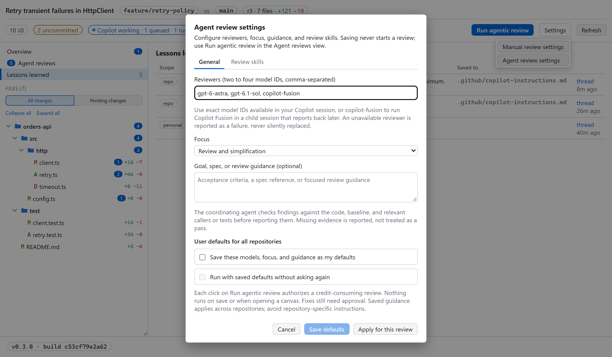
</picture>

<picture>
  <source media="(prefers-color-scheme: dark)" srcset="docs/images/review-skills-dark.png">
  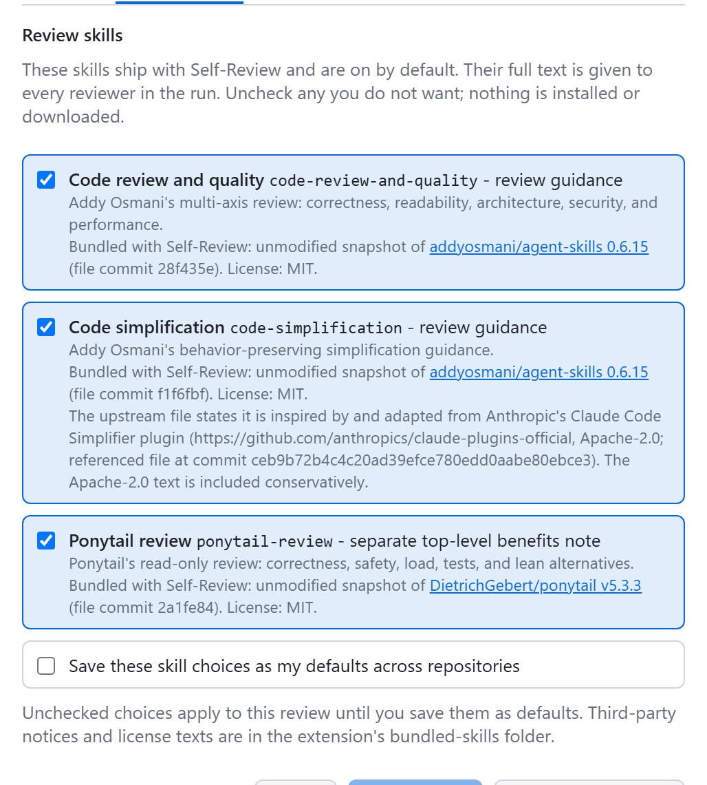
</picture>

Addy's skills guide normal review findings. Ponytail review is distinct from the session-wide `ponytail` coding mode: its upstream read-only workflow checks correctness, safety/load/tests, and lean alternatives. In Self-Review, selected reviewers report separately whether they applied it and list only validated simplification opportunities with concrete benefits and source/baseline/validation evidence. After discussion and unanimous agreement, supported opportunities are deduplicated into **one top-level overview note**, not inline comments or approvable fixes. Each agreed group appears once with its contributors; each reviewer's full wording and evidence remain in the run's Ponytail details, including pending and unpublished opportunities labeled by consensus status. Without unanimous participation or agreed benefits, no benefits comment is created; the run shows the limitation. Proposed savings are not implemented or measured outcomes, and upstream benchmark numbers do not establish benefits for your change.

You can still ask for other installed host skills in the review guidance field. Reviews name only skills actually applied. Skills do not authorize mutation tests, automatic fixes, extra model calls, commits, publication, or paid reviews; each run still requires explicit authorization.

The built-in review approach draws on [Addy's evidence-based review and simplification workflows](https://github.com/addyosmani/agent-skills), [Matt Pocock's standards/spec separation](https://github.com/mattpocock/skills/tree/main/skills/engineering/code-review), and [poteto's adversarial review perspectives](https://github.com/poteto/noodle/tree/main/.agents/skills/adversarial-review). It works without installing those skills.

## What's inside

| Path | What it is |
|------|------------|
| [`extensions/self-review/`](extensions/self-review/) | The canvas: diff view, threads, comment delivery, and the actions the agent uses to reply. |
| [`skills/self-review/`](skills/self-review/) | The skill that tells the agent how to run the review loop: open the right comparison, process comments, reply, and propose reusable guidelines. |
| [`.github/skills/create-pr/`](.github/skills/create-pr/) | A repository-local workflow for creating or finishing a PR, addressing review feedback, verifying CI, and guarded automatic merging. |
| [`.github/REVIEW.md`](.github/REVIEW.md) | This repository's self-review checklist: check the change against its source issue (Spec) and documented rules (Standards), find open issues it solves, and choose `Closes`/`Refs` links for the PR. |

Any repository can add its own `.github/REVIEW.md`; the self-review skill reads it at the start of every review and follows it alongside the repository instructions.

Canvases are a GitHub Copilot app feature. The skill loads in Copilot CLI too, but without the canvas there is nothing to comment on.
Ask Copilot **"create PR"** to run the workflow; it merges only when its review and CI gates pass and no unusual signals remain. Say **"manual mode"** or **"no merge"** to leave the PR open.
The PR body uses `Closes #N` for a completed issue on a default-branch PR. A partial fix or a PR to another branch uses `Refs #N` and says what remains.
After every push or PR creation, the workflow reuses a verified matching
Self-Review canvas or opens one automatically, preserving the user's existing
review and filters while showing the whole PR on the correct checkout and base.

After a verified merge, the workflow fetches and verifies `origin/main`, then
switches the PR worktree to that fresh tip (detached if another worktree owns
`main`) and refreshes the All changes canvas so the merged PR diff is no longer
shown. It removes the local PR branch only when the worktree is clean and the
branch has no unpushed commits; otherwise it stops and reports without
discarding work. If the merge commit is not on `origin/main` after one refetch,
it defers cleanup and reports the blocker without changing the checkout.

## Updating

```bash
copilot plugin update self-review-canvas@self-review-canvas
```

Then start a new session.

### Upgrading from Manual Review Canvas

This project was renamed from Manual Review Canvas, and its plugin, marketplace, canvas, and skill IDs changed. Replace the old install:

```bash
copilot plugin uninstall manual-review-canvas@manual-review-canvas
copilot plugin marketplace remove manual-review-canvas
copilot plugin marketplace add SergeyTeplyakov/Self-Review
copilot plugin install self-review-canvas@self-review-canvas
```

Then start a new session. On first start, existing reviews and settings are copied from `~/.copilot/extension-data/manual-review` to `~/.copilot/extension-data/self-review`. The old directory is left in place; delete it yourself once you no longer run the old version.

## Hacking on it

### Completion-time review

The extension carries its own completion guidance using the SDK's documented
`onSessionStart` and `onUserPromptSubmitted` hooks and `additionalContext`.
After finishing a code-changing task, the agent is instructed to open the
matching human-led review if none is open, or propose it with an explanation when canvas
tools or the provider are unavailable. It discovers live schemas, verifies the
actual worktree and comparison, preserves scope/filters, and reuses a matching
panel and reads its checkout, scope and revision to verify the result. Open
panels refresh themselves on checkout changes; manual refresh is a fallback,
not a per-edit agent responsibility. Read-only work, explicit opt-outs, and comment-processing review loops
are excluded. Opening a diff never starts a paid agent review or authorizes
commits or publication.

This is **advisory agent guidance**, not a guaranteed automatic-open feature:
these hooks run at session start and prompt submission, not at verified task
completion, and cannot force a tool call. The extension does not send itself a
completion prompt or infer completion from an idle event. Existing sessions
need the updated extension loaded before the hooks can supply this context.

### Development checks

Clone the repo, then run `copilot plugin marketplace add <path-to-clone>` and
`copilot plugin install self-review-canvas@self-review-canvas`. The checked-in
`extensions/self-review/dist/` is the generated runtime distribution, so installing
the plugin does not require TypeScript or a build step. The root `extension.mjs`
remains the discovered entry point and forwards to emitted `dist/extension.mjs`.

Development checks require Node 22.12+ and npm. From the repository root:

```bash
npm ci --ignore-scripts --omit=optional
npm run typecheck
npm test
```

For just the [parallel comment assessment](evals/parallel-comments.md), run
`npm run eval:parallel-comments`. It checks repository opt-in, ordering, and
coordinated edits. A provider integration test sends two comments through the
canvas HTTP API and verifies the second gets a reply while the first is still
processing. The host and workers are simulated; the assessment includes a
separate live check for real-agent answers and edits.

`npm run build` compiles the TypeScript provider and browser renderer to ESM and
copies static browser assets and bundled skill snapshots into
`extensions/self-review/dist/`.
`npm test` performs that build first, then exercises the emitted modules and an
installation-shaped copy. A test (including its hooks) that runs longer than two
minutes fails instead of stalling the run. Commit generated `dist/` changes
together with source changes; CI checks that the distribution is up to date.

For a local provider installation, `npm run deploy:provider -- deploy --backup
<new-backup-directory> --receipt <new-receipt.json>` checks that the checkout's
distribution matches a fresh build, verifies a hash-checked backup, and replaces
only the installed `dist`. Reload the provider through the host afterward, then
run `npm run deploy:provider -- verify --receipt <new-receipt.json> --url
<provider-url>` to compare files and the served build ID. To roll back, use
`npm run deploy:provider -- restore --backup <backup-directory> --receipt
<new-receipt.json>` and reload again. Verify the restored build against the
backup with `npm run deploy:provider -- verify --backup <backup-directory>
--receipt <new-receipt.json> --url <provider-url>`; without `--backup`, verify
compares against the checkout. The provider URL can be the canvas URL, including
its `t` authentication parameter. Each operation writes a JSON receipt with
file hashes, build IDs, Git commit, and before/after data-directory manifests; it
reports changes to that directory but does not modify reviews, settings, or
learned rules. Receipts and backups must not already exist. `--checkout`,
`--install`, and `--data` select alternative paths; defaults are the current
checkout and the user's Copilot installation and data directories. Keep backups
and receipts outside all three directories. This is separate from the build and
does not reload or install the provider automatically.

The SDK package is a **development-only** source of its public canvas types, pinned
for reproducible checking; the installed Copilot runtime still supplies the SDK at
run time. No extension-local SDK installation is needed. If `tsc` or SDK declarations
are missing, run the install command above rather than substituting ambient stubs.
CI runs the same type checks and regression suite on Ubuntu with Node 22.12.0
and current Node 22, and on Windows with current Node 22. Each CI job times out
after 15 minutes, including builds and cleanup; locally, the two-minute timeout
applies to individual tests rather than the whole run.

All handwritten implementation code is TypeScript: the provider and backend live
in `src/`, including the renderer in `src/web/app.ts`; tests, development scripts,
and screenshot tooling are also compiled and strictly checked. The Node and browser
projects use separate libraries and ambient types, with shared contracts in
`extensions/self-review/types/contracts.d.ts`. Compile-only negative fixtures
ensure invalid settings modes, request envelopes, and checkbox values are rejected.
External HTTP, SDK, and persisted data still receive runtime validation; migrating
the implementation does not change stored reviews or settings.

Development tooling and tests compile into ignored `.build/` output before
execution, rather than relying on native TypeScript stripping, so Node 22.12+
remains supported. The checked-in `dist/` stays host-facing JavaScript ESM; the
one-line `extensions/self-review/extension.mjs` is the required discovery bootstrap.
Generated output, minimal platform bootstraps, and unmodified third-party snapshots
are the only JavaScript exceptions. Repository instructions require TypeScript for
new handwritten code as well.

The screenshots in this README come from a script that builds a demo repository, seeds a review, and captures the real canvas in light and dark themes with Playwright, using your installed Edge or Chrome. It never installs third-party skills or dispatches agent reviews. Build the runtime first:

```bash
npm run build
cd docs/screenshots
npm install
npm run render
```

Pass `-- --keep` to `npm run render` to leave the demo review running and print its URL.

To work on image diffs in parallel, use one branch and worktree per session. From the worktree root, run `npm ci` on first use, then `npm run preview:images`. Open the printed loopback URL and select `settings.png`, `added.png`, or `removed.png`. Each run uses that worktree's build, a temporary Git repository and review store, and its own port. It does not install or reload the shared Copilot provider or send comments to an agent. Stop it with Ctrl+C.

Run `npm run render -- --check-refresh-layout` from `docs/screenshots` after building to check that the file tree, Overview pane, and Refresh button stay in place during refresh, an error, and a successful retry. This opt-in check uses the same browser prerequisites and does not regenerate screenshots.

## Status

Early. Issues and PRs welcome.

## License

MIT. See [LICENSE](LICENSE).
