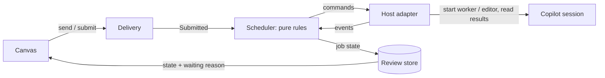
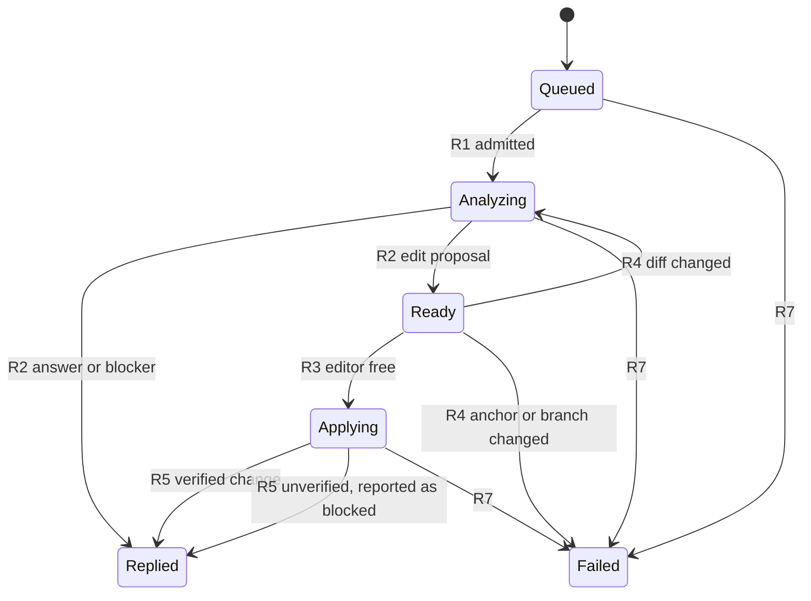

# Comment processing

Status: **implementation in progress**. This document describes how Self-Review
processes sent comments when **Concurrent comments** is 2–4. Serial delivery
(limit 1) remains the default.

## Goals

1. A sent comment starts as soon as there is capacity. It never waits for the
   chat's current turn or for unrelated comments to finish.
2. The rules live in one pure module and in the rule table below. A behavior
   change starts by changing a rule here.
3. Every comment that is not running shows why it is waiting.
4. Analysis is read-only in the reviewed checkout. Edits are applied one at a
   time in that same checkout. There are no checkout copies.

## Vocabulary

| Term | Meaning |
| --- | --- |
| **Job** | One sent user message that needs an answer. A thread can have several jobs over time. |
| **Limit** | The repository's **Concurrent comments** setting (2–4). It caps the number of jobs being analyzed at the same time. |
| **Worker** | A read-only background agent that analyzes one job and returns an answer or an edit proposal. |
| **Editor** | The single writer that applies one authorized proposal at a time. |
| **Scheduler** | The pure module that owns job states and the rules. It performs no I/O. |
| **Host adapter** | Turns scheduler commands into Copilot SDK calls, and SDK signals into scheduler events. |

## Pieces



- **Scheduler**: `step(state, event) → { state, commands }`. It has no
  timers, prompts, files, or SDK calls, and its tests are tables of events and
  expected commands.
- **Host adapter**: the only place that knows about prompts, `session.send`,
  background tasks, `session.idle`, and provider restarts.
- **Store**: persists job states so the UI and a restarted provider see the
  same truth.
- **UI**: renders job states and waiting reasons. It does not infer progress
  from whether the chat is busy.

## Comment lifetime

The diagram starts when a comment is **sent**; a held draft is not queued.
With a limit of 4 and three comments analyzing in other threads, a newly
sent comment on a free thread should move from **Queued** to **Analyzing**
without waiting for any of the three to finish. Four is a ceiling, not a
batch size: even a single eligible comment should start on its own.

**Implemented:** dispatch and wake-up prompts are sent immediately. The chat
coordinator admits eligible jobs up to the configured limit on each scheduler
call, including while earlier workers are still analyzing. A job that cannot
fit waits for capacity; a same-thread follow-up waits for the earlier job in
that thread. The limit is a ceiling, not a batch size.



| State | Running? | UI label | Waiting reason shown |
| --- | --- | --- | --- |
| Queued | no | Queued | `capacity`, `thread busy`, or `starting` |
| Analyzing | yes, one worker | Analyzing | none |
| Ready | no | Ready to apply | `editor busy` |
| Applying | yes, the editor | Applying | none |
| Replied | no | the reply | none |
| Failed | no | Failed + reason | the reason |

## Rules

**R1 Admission.** Queued jobs are considered in send order. After each
submission or worker result, a job is admitted when both hold:

- fewer than *limit* jobs are Analyzing, and
- no other job from the same thread is Analyzing, Ready, or Applying.

A job blocked only by its own thread does not block jobs on other threads.
Admission is evaluated when the coordinator takes work. New submissions send
an immediate wake-up so that the coordinator can take work without waiting for
the current chat turn to finish.

**R2 Analysis outcome.** A worker returns exactly one result:

- an answer, blocker, disagreement, or question → post it as the reply →
  Replied;
- a proposal for an explicitly requested edit → Ready;
- a proposal for a read-only command such as `/explain` → post it as blocked
  (read-only commands never edit) → Replied.

**R3 Edits.** At most one job is Applying. To avoid analyzing a moving checkout,
the current implementation starts the oldest Ready job only after active
analyses have reported. Whether to admit new analyses during an edit remains
open (see D3).

**R4 Staleness.** When a Ready job is about to apply:

- if its comment anchor became outdated, or the branch or HEAD changed →
  Failed with "recheck the target and resend";
- otherwise, if the reviewed diff changed since its analysis → back to
  Analyzing for a fresh proposal. Re-analysis counts against the limit.

**R5 Verification.** The editor reports `changed` only with a verification
step, and the reviewed diff must actually have changed. Otherwise the reply is
recorded as blocked with the reason.

**R6 One reply per job.** A job gets exactly one reply. Duplicate or late
worker results for a finished job are ignored.

**R7 Failures.**

- A worker fails or is cancelled → Failed with the worker's error.
- A provider restart moves never-started Queued jobs and read-only Analyzing
  jobs back to Queued (see D4), and fails an Applying job with "interrupted,
  check the reviewed checkout", because its edit may be partial.
- A host that cannot start workers fails the jobs with the host's reason.
  Jobs never fall back to serial delivery silently.

## Scheduler interface

```ts
type Event =
  | { kind: "submitted"; jobs: Job[]; limit: number }
  | { kind: "worker-reported"; jobId: string; result: AnalysisResult }
  | { kind: "worker-failed"; jobId: string; error: string }
  | { kind: "edit-reported"; jobId: string; report: EditReport; diffChanged: boolean }
  | { kind: "edit-check"; jobId: string; diffChanged: boolean; anchorOrBranchChanged: boolean }
  | { kind: "provider-restarted" };

type Command =
  | { kind: "start-worker"; jobId: string }
  | { kind: "check-edit"; jobId: string }
  | { kind: "start-editor"; jobId: string }
  | { kind: "reply"; jobId: string; report: Report }
  | { kind: "fail"; jobId: string; reason: string };

function step(state: SchedulerState, event: Event): { state: SchedulerState; commands: Command[] };
```

`edit-check` is the adapter's answer to `check-edit`; the scheduler stays pure
because the adapter does the Git and diff checks.

## Host adapter: who runs workers (decision D1)

**Today** the chat model is the coordinator. Self-Review sends an immediate
dispatch prompt; the chat calls `take_comment_workers`, starts background tasks
itself, and reports through `finish_comment_worker`. New comments send an
immediate wake-up to the same run. The provider cannot see the workers, so it
can't tell whether they actually started or ran in parallel.

**Option A (recommended, needs a spike).** The provider starts each worker
itself with `session.rpc.tasks.startAgent({ agentType: "explore", prompt,
name })`. On `session.background_tasks_changed` it calls `tasks.list()` and reads
each task's `status`, `result`, and `error`. Worker start, completion, and
failure become events the provider observes directly, with no dependence on
the chat's turn. These SDK APIs are marked experimental.

The spike must confirm:
- starting a worker from the provider works in this host;
- `result` holds the worker's final answer;
- the chat model is not woken or confused by completion notifications;
- write permissions for the editor.

**Option B (implemented).** Keep the chat coordinator, send dispatch and
wake-up prompts with `mode: "immediate"`, and use rolling R1 admission instead
of worker waves. This removes the queue's dependency on the current chat turn,
but correctness still depends on the chat model following the coordinator
prompt.

## Host signals

| Signal | Today | Target |
| --- | --- | --- |
| Comment sent | Dispatch prompt sent with `mode: "immediate"`; coordinator takes up to the available capacity | Same; jobs start as soon as the coordinator takes them |
| New comment while jobs run | Immediate wake-up; next take admits it if R1 allows | Same |
| Worker finishes | Coordinator reports with `finish_comment_worker`; the next take fills any freed slot | A: from `tasks.list()`; B: from `finish_comment_worker` |
| Edit | Starts after active analyses report; one editor at a time | R3: after analyses report; D3 may later allow analysis during edits |
| `session.idle` with jobs in flight | Fails every remaining job | Not a scheduler event; with A, workers are tracked directly |
| Provider restart | In-memory queue lost; queued and running jobs fail | R7 and D4 |
| Header status | "Copilot busy" from the chat's busy flag | Counts and reasons from job states |

## Decisions to review

- **D1 Worker launcher:** A (provider via `tasks.startAgent`, after a spike) or B
  (chat coordinator with immediate dispatch).
- **D2 Dispatch:** immediate. *Decided.*
- **D3 Analyses during an edit:** allowed (recommended: maximum parallelism;
  proposals are rechecked by R4, but an answer may describe a half-applied
  edit) or paused while an edit applies.
- **D4 Provider restart:** automatically re-queue never-started and read-only
  analyzing jobs (recommended: analysis has no side effects), or fail them and
  ask the user to resend.
- **D5 Editor under A:** a provider-started write agent, one at a time, or the
  chat model.
