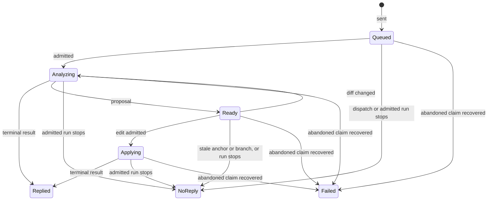

# Comment processing

This document separates the **current contract** from a **proposed future
design**. It covers immediate delivery with **Concurrent comments** set to 2–4;
serial processing (1) is the default. **Submit review** sends drafts together
in one prompt rather than dispatching parallel workers. Batch delivery keeps
the repository's saved concurrency limit for the next immediate review.

## Current contract

The implementation is in [`parallel-comments.mts`](../extensions/self-review/src/lib/parallel-comments.mts),
[`delivery.mts`](../extensions/self-review/src/lib/delivery.mts),
[`review-service.mts`](../extensions/self-review/src/lib/review-service.mts),
and the [provider actions](../extensions/self-review/src/extension.mts).
`ParallelComments` owns an in-memory queue and active jobs; it is not the pure
scheduler proposed below. Delivery state and phases are persisted with review
messages, but the queue and worker tasks are not restored from the store.

The owning conversation is the coordinator. The provider sends immediate
dispatch and wake-up prompts; the conversation calls `take_comment_workers`,
starts the returned read-only background tasks, reports results with
`finish_comment_worker`, and applies requested edits itself. Worker behavior
and actual host concurrency depend on the conversation and host following
those prompts; the provider does not directly observe the background tasks.
The reviewed checkout is shared, not copied. The configured limit is a ceiling
on analyses, not a batch size.

### Comment lifetime

These are conceptual phases, not independent persisted delivery states.



The store records `queued`, `processing`, `replied`, `no-reply`, or `failed`,
in addition to the earlier `draft` and `saving` states. Analyzing, ready and
applying are phases of `processing`; the UI displays **Analyzing comment**,
**Waiting to apply**, or **Applying change**. A queued comment does not
currently display a specific capacity or thread-busy reason. `no-reply` and
`failed` can be resent.

### Rules and evidence

Links below identify tests and their limits; they do not imply that
prompt instructions are technically enforced on a background agent.

**R1 — Admission.** On each take, the queue is scanned in order for the first
waiting review, up to available analysis capacity. Active work in the same
thread blocks a follow-up, but not another thread. Ready proposals occupy their
thread but not an analysis slot. New sends immediately wake the run; admission
still requires the coordinator to take work.
[Rolling admission and same-thread ordering](../extensions/self-review/test/parallel-comments.test.mts#L80);
[immediate wake-up](../extensions/self-review/test/parallel-comments.test.mts#L143);
[busy-host acceptance test](../extensions/self-review/test/parallel-comments-provider.test.mts).

**R2 — Analysis outcome.** A nonempty proposal for a non-command comment
becomes ready without a reply. A proposal for a recognized read-only command
is replied to as blocked. Other reports become replies. Prompts ask workers
to analyze read-only and propose only explicitly requested edits; the provider
does not independently determine whether an ordinary comment authorizes an
edit or enforce the worker's filesystem permissions.
[Proposal and answers](../extensions/self-review/test/parallel-comments.test.mts#L80);
[read-only command](../extensions/self-review/test/parallel-comments.test.mts#L193).

**R3 — Edits.** The coordinator is instructed to be the only writer. A take
admits eligible queued analyses before choosing a ready proposal; an edit
starts only once the current review has no unfinished analyses. While that
edit is applying, takes do not admit more work. Ready jobs are selected in
active-job insertion order, not necessarily proposal completion order.
[Admission and edit serialization](../extensions/self-review/test/parallel-comments.test.mts#L80).
Actual write isolation and every ordering edge case are not independently
enforced or tested.

**R4 — Staleness.** Before applying a proposal, the provider refreshes the
review. An outdated anchor or changed branch or HEAD fails the attempt with a
recheck/resend reason; otherwise a changed review revision causes fresh
analysis before editing.
[Re-analysis after earlier and concurrent edits](../extensions/self-review/test/parallel-comments.test.mts#L165).
The anchor, branch and HEAD rejection paths are **not directly tested** there.

**R5 — Verification.** A `changed` report is blocked unless the job is
applying, the report includes nonempty verification, and refresh observes a
different review revision. The provider checks for a reported verification
step, not whether the step was actually run.
[Successful changed report](../extensions/self-review/test/parallel-comments.test.mts#L80).
The missing-verification and unchanged-revision rejection paths are **not
directly tested** in the parallel-comment tests.

**R6 — One reply per attempt.** A terminal report replies to its specific
comment and removes the active job; a duplicate result for that job is
rejected while the run remains active. The store also checks the attempt and
processing state for parallel replies.
[Duplicate result and separate thread replies](../extensions/self-review/test/parallel-comments.test.mts#L80).
This is not a guarantee of a reply: failed or interrupted attempts may have
none. Results for an inactive run are rejected as an error.

**R7 — Failures and recovery.** A failed dispatch marks waiting jobs
`no-reply` with the send error; preparation or edit recheck errors also mark
the affected job `no-reply`. If an admitted run goes idle before its results,
remaining active and waiting jobs become `no-reply` with a resend reason.
The coordinator is instructed to report worker blockers; there is no direct
worker-failure event or automatic observation of worker errors. There is no
silent serial fallback.
[Interrupted host turn and retry](../extensions/self-review/test/parallel-comments.test.mts#L193).
Dispatch failure and individual worker failure paths are **not directly tested**
in the parallel-comment tests.

When a stopped provider's abandoned claim is recovered, queued and processing
parallel attempts become `failed`, not re-queued. Queued attempts say analysis
did not start and ask for a resend; processing attempts warn to check the
checkout for applied changes before resending. Recovery requires a recorded
claim PID that is different from the current provider and no longer alive;
live claims are left alone.
[Abandoned parallel claims](../extensions/self-review/test/review-fixes.test.mts#L451);
[stopped versus live claims and resend](../extensions/self-review/test/review-fixes.test.mts#L428).

### Acceptance criterion: busy host

While the first worker is still running, a second independent comment must
dispatch immediately and receive its reply before the first worker finishes.
The [provider integration test](../extensions/self-review/test/parallel-comments-provider.test.mts)
exercises this with a simulated busy host and explicitly driven worker results;
it does not prove real host task scheduling or model compliance.

## Proposed / future design

The following is design exploration, **not the current implementation**.
It is not covered by the current tests unless explicitly noted.

### Pure scheduler interface

A possible scheduler would isolate rules from I/O, with an adapter translating
host signals to events and performing commands:

```ts
type Event =
  | { kind: "submitted"; jobs: Job[]; limit: number }
  | { kind: "worker-reported"; jobId: string; result: AnalysisResult }
  | { kind: "worker-failed"; jobId: string; error: string }
  | { kind: "edit-reported"; jobId: string; report: EditReport; diffChanged: boolean }
  | { kind: "edit-check"; jobId: string; diffChanged: boolean; anchorOrBranchChanged: boolean }
  | { kind: "provider-restarted" };

type Command =
  | { kind: "start-worker"; jobId: string }
  | { kind: "check-edit"; jobId: string }
  | { kind: "start-editor"; jobId: string }
  | { kind: "reply"; jobId: string; report: Report }
  | { kind: "fail"; jobId: string; reason: string };

function step(state: SchedulerState, event: Event): { state: SchedulerState; commands: Command[] };
```

The adapter would answer `check-edit` with `edit-check`; the scheduler would
have no Git, file, timer, prompt, or SDK I/O. Explicit waiting reasons such
as capacity, thread busy, and editor busy are also proposed, not current UI.

### Decisions

- **D1 — Worker launcher:** Today the chat coordinator starts workers (option
  B); [provider integration test](../extensions/self-review/test/parallel-comments-provider.test.mts)
  drives the coordinator actions but does not start real workers. Proposed
  option A would have the provider start and observe tasks via experimental SDK
  APIs. A spike must verify task startup, results, notifications and editor
  permissions; **untested/proposed**.
- **D2 — Dispatch:** Immediate dispatch and wake-up are implemented.
  [Busy-host test](../extensions/self-review/test/parallel-comments-provider.test.mts)
  checks the send mode and second reply.
- **D3 — Analysis during edits:** Today new analyses are not admitted while
  an edit is applying; [serialization test](../extensions/self-review/test/parallel-comments.test.mts#L80).
  Allowing analyses during an edit is **untested/proposed** and could expose
  partially applied changes to an answer.
- **D4 — Provider restart:** Today abandoned queued and processing claims
  fail and require resend, as described in R7. Automatically re-queuing
  never-started and read-only analyzing jobs, while failing interrupted edits,
  is **untested/proposed**, not implemented.
  [Current recovery test](../extensions/self-review/test/review-fixes.test.mts#L451).
- **D5 — Editor under option A:** A provider-started write agent or the chat
  coordinator are alternatives; **untested/proposed**. Today the coordinator
  applies edits under option B ([serialization test](../extensions/self-review/test/parallel-comments.test.mts#L80)).
